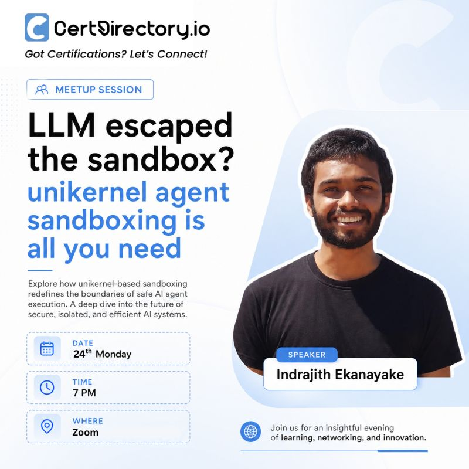

[Sajeeva Nambadawa](https://www.linkedin.com/in/sajeeval/) from CertDirectory.io invited me for a meetup on Agent sandboxing. As apart of [[lfx|LFX'26]] I've been working on urunc at the time. So I went with the flashy title "Agent Escaped the Sandbox? Unikernel Agent Sandboxing is all you need (Possibly)".

It was fun overall, the session was held online and there was a participation around 150. To my surprise many of audience shared there learnings on LinkedIn ccing me which was really nice gesture. Some of which I'll share below if I get a time to find those  [1](https://lnkd.in/p/gggGPa78), [2](https://lnkd.in/p/g56CsUmr), [3](https://lnkd.in/p/g_ZiW2zB)

**Event Slides:**
<iframe src="https://drive.google.com/file/d/1M7GDQubW4szqj4f-i0u7wrtagR5AAal4/preview" width="640" height="480"></iframe>

**Event Photos:**

  

